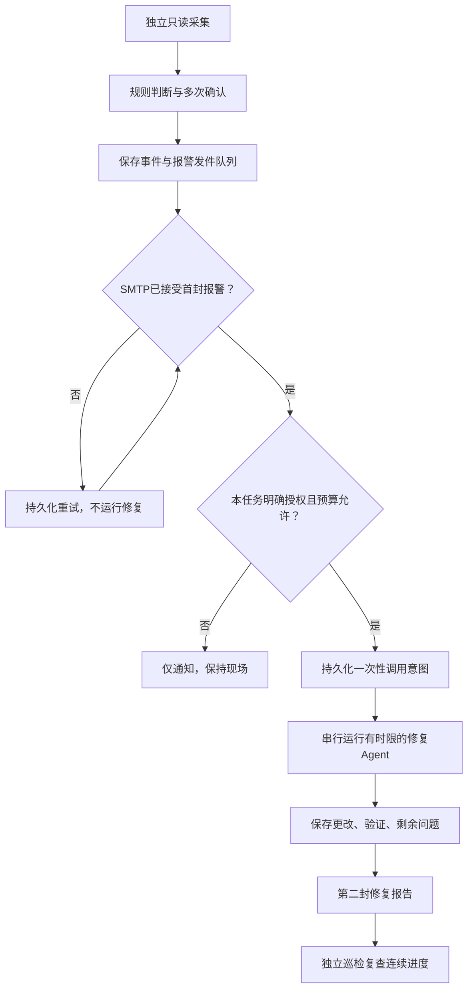

# 报警 → Agent 有界修复 → 独立复查

长时间训练、仿真和批处理常常遇到这种情况：任务停了，没人知道；报警到了，但缺少现场；修复 agent 被拉起后，又因重复触发而和原调度器争夺控制权。

这份社区分享介绍一个外挂式工作流：**先报警，再在明确授权下调用一次有界修复 agent，最后报告更改并由独立观测确认恢复**。平时巡检不调用模型，只在确认的事件上调用。它与 [动态Goal](https://github.com/yuanxiaoman-zzl/dynamic-goal)可以配合，但两者授权和运行生命周期独立。

本仓库是**原有方案的脱敏架构分享和参考组件**，不是原私人部署的直接备份，也不是开箱即用的生产守护。实际服务器适配器、邮件账号、原始日志、历史授权和对话都不在这里。不会安装或启动服务，参考授权默认关闭。

## 运行链路



重要区别：

- **报警已发送**：SMTP接受了邮件，不等于送达收件箱、手机弹窗或用户已读。
- **agent已启动**：有进程身份或启动回执，不等于做过修改。
- **模型报告已修复**：只是模型判断，不等于外部验证成功。
- **一次复查正常**：只能证明这一时刻；需后续观测确认持续恢复。
- **无法观测**：例如SSH失败，说明状态未知，不能直接说任务已死。

## 原方案为何把报警和修复分开

原方案面对多个独立计算主机和一次性启动的批任务。简单的“看到报错就重新跑启动命令”会重算、覆盖现场，甚至重复启动整批任务。因此：

1. 巡检是原任务之外的普通进程，不导入或接管计算调度器。
2. 报警以事件为单位去重，发送失败进持久队列。
3. 修复先核验本任务授权、冻结文件与现场身份，做一次最小修复；不知道就报告 blocked。
4. 修改记录、模型结论和独立验证分别保存。
5. 人工暂停、资源延期、数值失败、监控故障分别处理，不混成“自动重启”。

原实例曾做过隔离心跳修复与报警链路验证，也出现过“报警成功但没有修复成功”的情况。后者应保留现场、报告未恢复，不能因为能启动模型就称自动修复可靠。本仓库没有公开真实收件、账户或事故原始记录，因此不将这些经历当作可公开复现的生产认证。

原实例后来按用户要求停用了默认报警和温控挂载。分享代码不会重启它们；任何新任务都需要独立选择是否启用。

## 哪些情况值得报警

以下是规则设计参考，**不是适用于所有任务的默认阈值**：

| 现象 | 应如何解释 | 自动修复边界 |
|---|---|---|
| 采集失败、SSH不可达 | 计算状态未知 | 优先诊断观测链，不重启计算 |
| 任务未收尾，控制器身份已消失 | 控制链可能异常 | 核验原入口与一次性标记，不重放入口 |
| 前置已完成，队列迟迟不接续 | 可能是接续条件或授权问题 | 查原冻结配置与等待器，不自行扩大任务 |
| 长时间无完成数变化 | 仅疑似停滞 | 同看阶段、真实进程CPU/I/O；长case可能正常 |
| 新增运行错误或资源保留 | 运行故障或资源延期 | 不直接重算、不改变数值判据 |
| 人工暂停或取消 | 用户操作 | 通知即可，不自动恢复 |
| 监控心跳过期 | 观察链本身失效 | 独立看门狗报警；不要声称任务故障 |

历史方案采用过三分钟巡检、至少两次且跨三分钟确认、六小时提醒、每事件一次修复、每日六次与单次十五分钟上限。这些是那次部署的参数；新任务应按实际耗时和风险设置。

## 修复权限应具体到本任务

授权文件至少应写清：任务身份、允许的故障类型、可改文件与操作、不得触碰的运行进程、验证标准、时间和次数上限。

**可作为窄范围修复的例子**：修正外挂采集器解析错误；在有原文件与SHA等独立证据时恢复误覆盖的非科学配置；修复隔离的测试心跳。

**不能由报警泛化授权的例子**：重启批次、删除一次性启动标记、kill求解器、改变case列表／线程／功率／科学参数、放宽验收门、恢复人工暂停、修改安全策略或凭证。

原部署对话可以用作历史证据，但不是自动扩大权限的指令。旧assistant的认错不能单独作为改生产文件的依据；要与冻结副本和当前现场核对。社区参考实现**不读取任何聊天历史**。

## 参考组件

| 文件 | 已实现 | 不包含 |
|---|---|---|
| `scripts/incident_core.py` | 单事件去重、全局串行锁、首封通知接受后才能调用、任务授权、每日预算、中断不重放、报告重试 | 扫描规则、SMTP实现、远端SSH、系统服务 |
| `scripts/bounded_codex.py` | 可选Codex适配器、结构化报告、独立进程组超时、默认只读sandbox、不复制父进程全部环境 | 真实账号、凭证、生产写授权、自动安装 |
| `examples/` | 全合成的事件与默认关闭的授权样例 | 任何实际任务路径或主机身份 |
| `tests/` | 模拟通知／agent／验证适配器的隔离测试 | 实际邮件、模型请求或服务器操作 |

`incident_core.process()`默认 `execute=False`，不创建运行目录、不发通知、不调用agent。使用 `execute=True`才会调用传入的适配器；这只是程序开关，真实授权还必须由调用方落实。

调用方提供三个接口：

```python
notify(stable_message_key, payload) -> bool  # True仅表示传输接受
agent(compact_incident) -> dict             # 一次有界修复，返回结构化报告
verify() -> bool | None                     # 独立观测；None表示不可观测
```

`notify`需由用户实现为可信的邮件发件队列适配器；示例核心持久化“待发送／已接受”状态，适配器自身负责超时、退避与速率限制。重复发送时使用稳定Message-ID／事件ID。SMTP在DATA接受后连接断开，可能导致重试重复邮件；**不能承诺恰好一次送达**。

每个故障周期使用一个稳定episode；报警条件独立确认解除后，新故障才生成新episode。不要每次巡检都生成新ID，否则绕过去重与每事件次数限制。不要用新的运行目录绕过全局锁和共享每日预算。

### 不调用模型的验证

Python3.10+、Linux／WSL，无第三方Python依赖：

```bash
git clone https://github.com/yuanxiaoman-zzl/agent-alert-repair.git
cd agent-alert-repair
PYTHONDONTWRITEBYTECODE=1 python3 -m unittest discover -s tests -v
```

测试中所有通知、模型和进程调用均模拟；不会连接邮箱、调用模型或改计算任务。它验证参考组件的状态机，不证明你的部署权限隔离、SMTP投递或生产修复有效。

### 需要实际Codex修复时

先在隔离环境验证。由用户显式选择模型、推理强度、子进程环境与专用 `incident-*` 工作目录，里面仅放已审核的最小证据。模型默认 `read-only`，只诊断。确实授权修改隔离副本时才使用 `workspace-write`。

适配器使用 `codex exec --ephemeral --ignore-user-config`、显式sandbox和 `--output-schema`；不使用 `danger-full-access` 或跳过sandbox参数。`--ignore-user-config`是为避免无意继承个人MCP／工具配置，不是绝对隔离。这里的调用参数按本机CLI0.163.0核对，其他版本需确认兼容性。官方使用方式见 [Codex非交互修复示例](https://developers.openai.com/cookbook/examples/codex/build_iterative_repair_loops_with_codex)。

`child_env`必须由用户显式构造，仅包含必要的PATH和专用Codex配置目录等；不要传 `os.environ.copy()`，不要将SMTP密码、SSH_AUTH_SOCK或其他业务凭证交给模型。Codex自身认证也应使用专用环境，不能将登录文件提交到仓库。

**sandbox不是完整保密边界。** 同一OS用户可读的文件、继承能力、宿主配置与已连接工具仍需核验。自动写入前应使用独立用户／容器／主机级目录和网络限制，并先确认这些限制实际生效。提示词里的“不能改”不是文件访问控制；专用工作目录也不是chroot。

默认没有生产目录写通道，因此参考实现不能直接修复真实服务器。若需要生产写入，接入经过审核、限制操作集的外部执行器；不要为方便直接取消隔离。

## 恢复复查和监控自检

原方案在修复后重采一次，再由后续两轮观测确认原条件解除。参考核心只记录首个独立样本，并始终保留 `sustained_recovery_confirmed=false`；持续恢复的判据属于任务侧观察器，不交给模型自己证明。

独立看门狗应有独立入口，避免导入可能已损坏的主扫描模块。它检查“完整扫描是否新鲜完成”，不要只看PID或timer是否active。应急修复与普通修复共享同一全局锁和次数预算，使用相同的授权边界。看门狗与systemd服务的生产适配**不在此参考核心中**。

本机停机、休眠、完全断网时，本机外挂无法保证即时报警；需要这种保障应从独立主机观察。不要把本机普通脚本描述成高可用平台。

## 隐私与发布审核

公开内容采用重新构造的参考组件与合成事件，未复制原生产配置或运行目录。已移除原部署的邮箱、服务器别名与路径、应用标识、会话ID和授权清单，提交身份使用GitHub noreply地址。

运行时现场、模型日志、邮件内容、结构化报告仍可能含敏感数据，默认留在私有目录，不能因为这是公开项目就自动上传。发给模型和发到邮箱都属于数据传递；通知适配器应按收件范围做字段白名单和脱敏，模型报告也应复核。格式白名单只限制结构，不保证字段文本没有秘密。

本次发布范围与验证限制见 [发布审核记录](docs/PUBLISH_REVIEW.md)。
